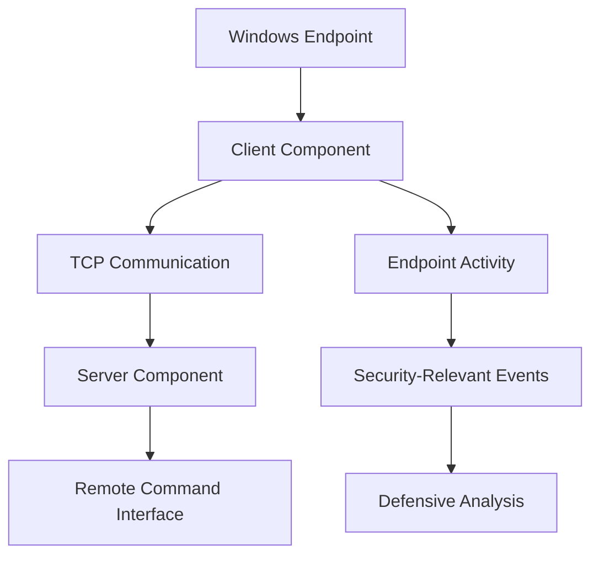

# Plastealer-BotNet v1.0
### Windows Malware Analysis & Cybersecurity Research

<p align="center">
  <strong>A Technical Study of a Windows-Based Botnet Architecture</strong>
</p>

<p align="center">
  
  
  
  
</p>

---

## Table of Contents

- [Overview](#overview)
- [Research Objectives](#research-objectives)
- [Technical Architecture](#technical-architecture)
- [Project Structure](#project-structure)
- [Component Analysis](#component-analysis)
- [Observed Capabilities](#observed-capabilities)
- [Security Analysis](#security-analysis)
- [Indicators of Compromise](#indicators-of-compromise)
- [Technology Stack](#technology-stack)
- [Security Recommendations](#security-recommendations)
- [Disclaimer](#disclaimer)
- [Author](#author)

---

## Overview

**Plastealer BotNet v1.0** is a Windows-oriented Python project implementing a client-server architecture with characteristics associated with Remote Access Trojans (RATs) and botnet infrastructure.

The repository contains separate client and server components, alongside Windows configuration artifacts and supporting utilities.

From a cybersecurity research perspective, the project provides an example for examining:

- Command-and-control (C2) architecture.
- Remote command execution risks.
- Keystroke monitoring behavior.
- File transfer mechanisms.
- Remote screen capture.
- Network discovery behavior.
- Windows persistence techniques.
- Antivirus exclusion and defense-evasion indicators.

This repository is documented for malware analysis, defensive security research, and understanding endpoint threats.

## Research Objectives

The primary research objectives are:

1. Examine the architecture of a Windows-based client-server threat.
2. Understand the security implications of remote command execution.
3. Identify suspicious endpoint activities.
4. Study persistence-related Windows artifacts.
5. Analyze potential data exposure and exfiltration risks.
6. Understand defensive detection and incident response opportunities.

## Technical Architecture

The repository implements two principal software components.

| Component | Responsibility |
|---|---|
| Client | Windows endpoint component |
| Server | Centralized client connection management |

### High-Level Architecture



The client and server communicate through TCP sockets.

The source code also contains several endpoint monitoring and file-handling capabilities that introduce significant security and privacy risks.

## Project Structure

```text
Plastealer-BotNet/
│
├── Plastealer_client/
│   ├── Plastealer_client.py
│   ├── Task_File_Plastealer.xml
│   ├── client.bat
│   └── Bat_To_Exe_Converter_(x64).exe
│
├── Plastealer_server/
│   ├── Plastealer_server.py
│   ├── ngrok.yml
│   ├── .gitignore
│   ├── pyvenv.cfg
│   └── gitkeep
│
└── README.md
```

## Component Analysis

### 1. Plastealer Client

**File:** `Plastealer_client/Plastealer_client.py`

The main Windows client implementation.

The source code contains:

- TCP socket communication.
- Remote command processing.
- PowerShell subprocess execution.
- File transfer handling.
- Screen capture functionality.
- Network host discovery.
- Embedded keyboard monitoring.
- Local keyboard activity logging.
- Reconnection behavior.

**Security significance:** The combination of remote execution, keyboard monitoring, and data transfer creates substantial endpoint compromise and information disclosure risks.

### 2. Plastealer Server

**File:** `Plastealer_server/Plastealer_server.py`

Implements the server-side communication and client management logic.

Its source code contains:

- TCP socket management.
- Concurrent listening threads.
- Connected-client tracking.
- Interactive command interface.
- File transfer handling.
- Screenshot reception.
- Network scan result processing.
- Keyboard-log reception.

**Security significance:** The server component represents a centralized control interface for connected endpoints.

### 3. Windows Batch Artifact

**File:** `Plastealer_client/client.bat`

Contains Windows commands associated with:

- Directory creation.
- Microsoft Defender exclusion modifications.
- File copying.
- Scheduled task registration.
- Hidden and system file attributes.

**Security significance:** These behaviors are important indicators when investigating defense evasion and unauthorized persistence.

### 4. Scheduled Task XML

**File:** `Plastealer_client/Task_File_Plastealer.xml`

Defines a Windows Scheduled Task configuration.

The inspected XML specifies:

- A logon trigger.
- An executable action.
- A designated working directory.
- Task execution settings.

**Security significance:** Scheduled tasks are commonly investigated during Windows persistence analysis.

### 5. ngrok Configuration

**File:** `Plastealer_server/ngrok.yml`

Contains a YAML configuration defining TCP tunnel entries.

The authentication token field is currently represented by a placeholder.

**Security significance:** Tunneling configurations should be reviewed carefully because they can expose internal services to external networks.

### 6. Git Configuration

**File:** `Plastealer_server/.gitignore`

Contains Git exclusion rules.

The current configuration excludes all files within its directory.

### 7. Python Environment Configuration

**File:** `Plastealer_server/pyvenv.cfg`

Contains metadata associated with a Python virtual environment, including the interpreter version and environment configuration.

This is environment metadata rather than application logic.

### 8. Binary Utility

**File:** `Plastealer_client/Bat_To_Exe_Converter_(x64).exe`

A Windows executable identified by its filename as a BAT-to-EXE conversion utility.

Its internal implementation and provenance have not been independently verified.

### 9. Placeholder File

**File:** `Plastealer_server/gitkeep`

An empty placeholder file used to preserve a directory in version control.

---

## Observed Capabilities

The following table summarizes capabilities identified through source-code inspection.

| Capability | Component |
|---|---|
| TCP communication | Client / Server |
| Remote command execution | Client |
| Keyboard monitoring | Client |
| File handling and transfer | Client / Server |
| Screen capture | Client |
| Network discovery | Client |
| Client connection management | Server |
| Windows scheduled-task configuration | Client artifacts |
| Microsoft Defender exclusion modification | Batch artifact |
| External TCP tunnel configuration | Server configuration |

These are observations of source-code behavior, not independently validated runtime results.

## Security Analysis

Several behaviors deserve particular attention during defensive investigation.

### Endpoint Monitoring

Keyboard monitoring and screen capture can expose sensitive user information.

### Remote Execution

Processing remotely supplied commands through PowerShell introduces a significant risk of unauthorized system control.

### Persistence

The scheduled-task configuration and associated batch file contain indicators of automatic execution and persistence.

### Defense Evasion

The batch file attempts to modify Microsoft Defender exclusions and conceal files through Windows attributes.

### Data Exposure

File transfer and keyboard-log handling create potential channels for unauthorized information disclosure.

### Network Exposure

The client contains a hardcoded remote endpoint, while the server and tunnel configuration define different port values.

The inspected configuration should therefore not be assumed to represent a verified, functional network deployment.

## Indicators of Compromise

The following artifacts can support defensive investigation:

| Artifact | Investigation Context |
|---|---|
| `C:\ProgramData\KL.txt` | Suspicious keyboard-log file |
| `C:\ProgramData\explorer` | Suspicious application directory |
| `Updateoffice` | Scheduled task name |
| `Task_File_Plastealer.xml` | Scheduled task artifact |
| `Plastealer_client.py` | Client source artifact |
| `Plastealer_server.py` | Server source artifact |

These are repository-derived investigation leads, not proof that a particular endpoint is infected.

## Technology Stack

| Technology | Purpose |
|---|---|
| Python | Application implementation |
| TCP Sockets | Network communication |
| PowerShell | Windows command execution |
| Windows Task Scheduler | Scheduled task configuration |
| XML | Windows task definition |
| YAML | Tunnel configuration |
| Threading | Concurrent execution |
| Pillow | Image capture support |
| pynput | Keyboard event monitoring |

### Python Dependencies

The client imports the following third-party libraries:

- `pynput`
- `Pillow`

Other imported modules are part of Python's standard library.

The repository does not currently provide a complete dependency lockfile.

## Security Recommendations

For defenders and security researchers:

- Never execute untrusted samples on production endpoints.
- Use isolated malware-analysis environments.
- Monitor suspicious scheduled-task creation.
- Audit Microsoft Defender exclusion changes.
- Investigate unexpected PowerShell execution.
- Monitor unusual outbound TCP connections.
- Review suspicious files created under system directories.
- Preserve forensic evidence during incident response.
- Rotate credentials if unauthorized exposure is suspected.

## Disclaimer

This repository contains code with potentially harmful capabilities, including credential exposure, unauthorized remote command execution, endpoint monitoring, persistence-related behavior, and defense-evasion indicators.

It is documented exclusively for educational, defensive cybersecurity research, and malware-analysis purposes.

Do not deploy, distribute, or execute these components against systems without explicit authorization.

The repository author and contributors are not responsible for unauthorized use or damage resulting from misuse.

**Use isolated analysis environments and follow applicable laws and organizational security policies.**

## Author

**Mohamed Nassar**

Cybersecurity Engineer | Penetration Testing | Malware Analysis

- GitHub: [@Mohamed258-SS](https://github.com/Mohamed258-SS)
- Repository: [Plastealer-BotNet](https://github.com/Mohamed258-SS/Plastealer-BotNet)

---

<p align="center">
  <strong>Cybersecurity Research | Malware Analysis | Defensive Security</strong>
</p>
